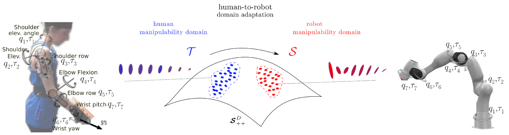

# human2robot-manipulability-domain-adaptation

Code for **"Human-to-Robot Manipulability Domain Adaptation with Parallel Transport and Manifold-Aware ICP"**
*Anna Reithmeir, Luis Figueredo, Sami Haddadin* — IEEE/RSJ IROS 2022

[Paper (DOI)](https://doi.org/10.1109/IROS47612.2022.9981796) · [arXiv](https://arxiv.org/abs/2208.07588)

**Keywords:** SPD Matrices · ICP · Riemannian Manifolds

## Overview




Manipulability — an ellipsoid describing how easily a kinematic system can move or exert force in different directions at a given pose — is a useful way to characterize human arm motion and to transfer it as a reference for robot motion planning. Directly copying manipulability ellipsoids from a human to a robot is not meaningful, though, since the two systems have different kinematic structures.

This repo implements a **manifold-aware domain adaptation method** for transferring manipulability information from a human arm to a robot manipulator. Manipulability matrices are treated as points on the Riemannian manifold of symmetric positive-definite (SPD) matrices, and a registration approach — a manifold-aware Iterative Closest Point (ICP) algorithm initialized via parallel transport, together with a matching strategy based on the ellipsoids' geometric properties — is used to adapt them across kinematic systems. The method is evaluated on both simple 2-DoF arms and more complex, human-arm-like 7-DoF systems.

## Repository contents

| Folder / file | Description |
|---|---|
| `src/`, `include/` | C++ implementation of the manifold-aware ICP and parallel transport method |
| `py/` | Python code (data processing / experiments) |
| `matlab/` | MATLAB code (manifold computations and/or plotting) |
| `vrep_scenes/` | V-REP / CoppeliaSim simulation scenes used for the robot experiments |
| `tests/` | Test files |
| `CMakeLists.txt` | C++ build configuration |
| `package.xml` | ROS package manifest |
| `map_dataset.sh`, `map_dataset_cv.sh`, `map_dataset_rhuman_panda.sh` | Shell scripts running the manipulability mapping pipeline for different dataset/experiment configurations |

> This repo currently has no README or repo description on GitHub — the breakdown above is inferred from the folder structure and the paper. Fill in the exact role of each `map_dataset_*.sh` script and add real build/run commands below once you've checked back against the code; I can't read inside the scripts from here.

## Setup

This is a ROS package (see `package.xml`) with a C++ core built via CMake/catkin.

```bash
# from within a catkin workspace, e.g. ~/catkin_ws/src
git clone https://github.com/annareithmeir/human2robot-manipulability-domain-adaptation.git
cd ~/catkin_ws
catkin_make   # or catkin build, depending on your workspace setup
```

> Add any Python/MATLAB dependency setup here (`requirements.txt`, MATLAB toolboxes, V-REP/CoppeliaSim version) so a reader can reproduce the environment.

## Usage

```bash
./map_dataset.sh
# or, for a specific dataset/experiment:
./map_dataset_cv.sh
./map_dataset_rhuman_panda.sh
```

> Replace this with the actual invocation (arguments, expected inputs/outputs) once confirmed against the scripts.

## Citation

If you use this code, please cite:

```bibtex
@inproceedings{reithmeir2022human,
  title     = {Human-to-Robot Manipulability Domain Adaptation with Parallel Transport and Manifold-Aware ICP},
  author    = {Reithmeir, Anna and Figueredo, Luis and Haddadin, Sami},
  booktitle = {2022 IEEE/RSJ International Conference on Intelligent Robots and Systems (IROS)},
  year      = {2022},
  doi       = {10.1109/IROS47612.2022.9981796}
}
```

## License

[](LICENSE)
